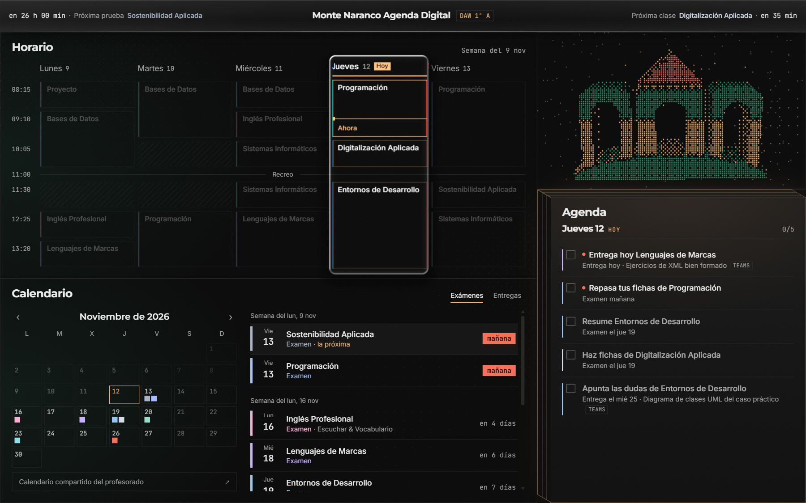
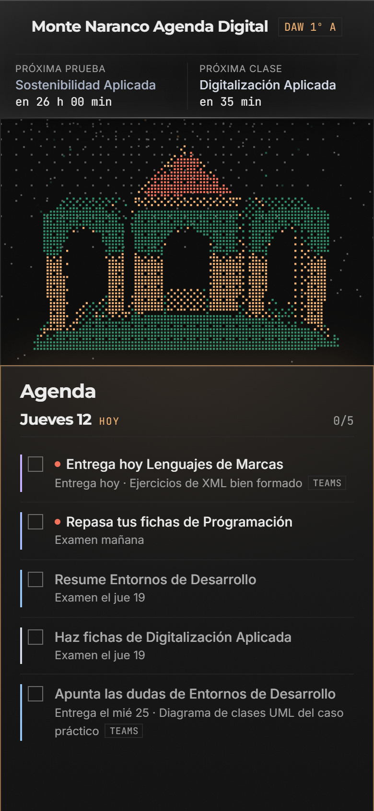
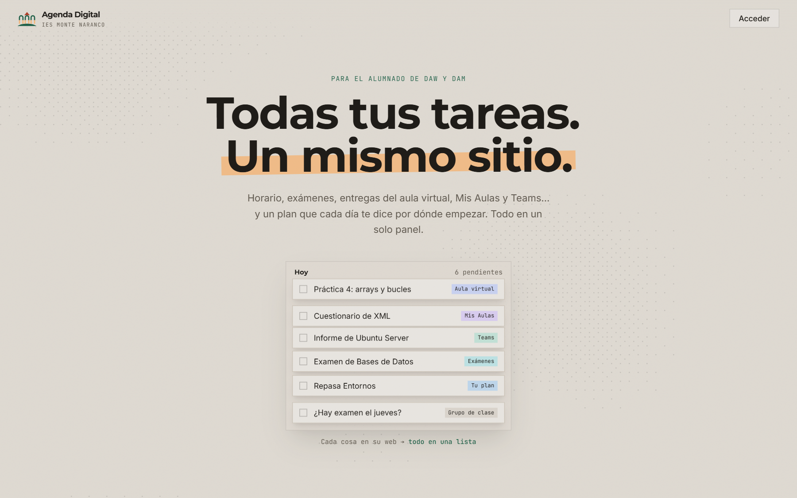
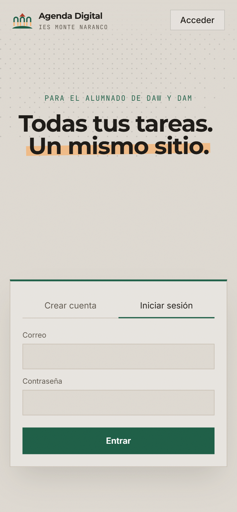
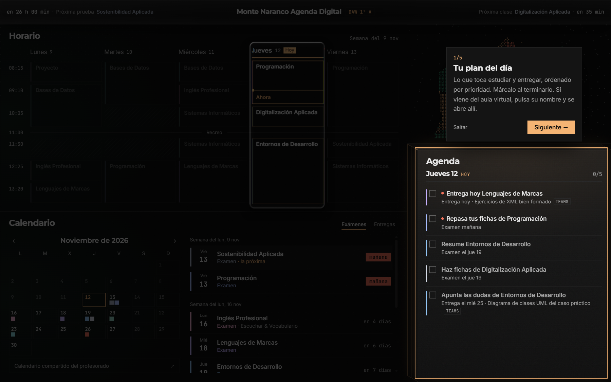
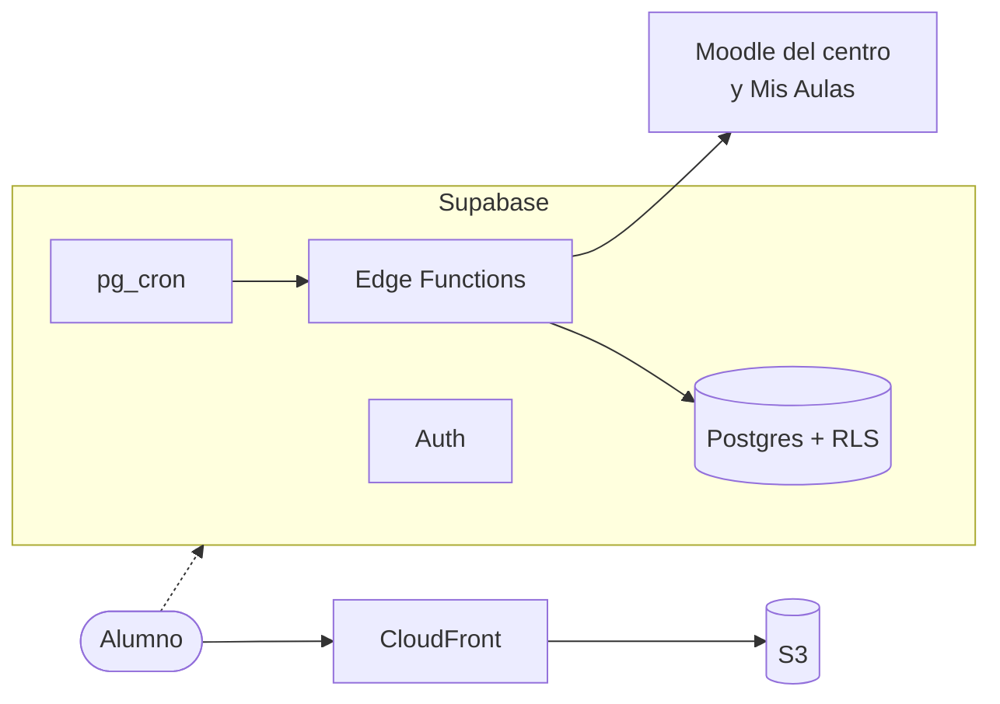

# Monte Naranco Agenda Digital

**Todas las tareas de un alumno de FP en un mismo sitio:** horario, exámenes, entregas de las plataformas del instituto y un plan para cada día.

**🌐 [agenda.alvaro.cloud](https://agenda.alvaro.cloud)** · React · TypeScript · Supabase · AWS

> **Terminado, sin mantenimiento.** La web funciona y sigue publicada, pero no seguiré desarrollándola ([por qué](#por-qué-no-continúa)). Es un proyecto personal de aprendizaje, no una herramienta oficial del IES Monte Naranco.

## El problema

Un alumno de mi ciclo consulta **cinco sitios** para saber qué tiene que hacer: Teams, el Moodle del instituto, un segundo Moodle ("Mis Aulas"), el horario en PDF y los avisos de exámenes. Esta web los junta en una pantalla y propone qué hacer cada día.

## Funcionalidades

- **Agenda del día:** exámenes y entregas ordenados por prioridad, solo de las asignaturas que tienes ese día. Se marcan como hechas y, si vienen del aula virtual, se abren con un clic con la sesión ya iniciada.
- **Horario con lupa de cristal (WebGL):** al pulsar una asignatura, toda la web se centra en ella.
- **Calendario** de exámenes y de entregas (las atrasadas arriba), y **cuentas atrás** hasta la próxima prueba y la próxima clase.
- **Entregas automáticas** del Moodle del centro y de Mis Aulas, cada 30 minutos. Las de Teams se apuntan a mano.
- **Cuentas:** registro, inicio de sesión y borrado con contraseña. Todo se sincroniza entre el móvil y el ordenador.
- **Configuración:** grupo, asignaturas convalidadas, sonido y animaciones simplificadas.
- **Primera visita:** configuración guiada paso a paso y un tutorial de 15 segundos.
- **Logo 3D como menú:** el logo del instituto, hecho de puntos, gira con el ratón (o con el giroscopio del móvil) y sus puertas son botones.

## Escritorio y móvil

| Escritorio | Móvil |
|---|---|
|  |  |
|  |  |
|  |  |

## Stack y arquitectura

| | |
|---|---|
| **Frontend** | React 19, TypeScript, Tailwind CSS 4, Motion y GSAP. Logo 3D, lupa y sonido con Canvas, WebGL y Web Audio, sin librerías. |
| **Backend** | **Supabase:** Auth, Postgres con RLS, Edge Functions y `pg_cron`. Sin servidor propio que mantener. |
| **Alojamiento** | **AWS:** bucket S3 privado servido por CloudFront con HTTPS. Se paga solo por uso y se publica con `npm run deploy`. |

Esquema de la base de datos

## Problemas que resolví

- **La agenda daba tirones.** Medí con el perfilador de Chrome en lugar de suponer: un efecto creaba un `` por letra y forzaba ~82 ms de *layout*. Lo reescribí moviendo un corte de texto. *Hay que medir antes de optimizar.*
- **Teams no se puede leer.** Educastur bloquea las apps externas en Microsoft 365. Evalué siete alternativas antes de programar nada y descarté las que iban contra las normas. *Investigar primero me ahorró construir algo imposible.*
- **Seguridad sin servidor.** La web habla directamente con la base de datos usando una clave pública. La protección está en Postgres: RLS en cada tabla y claves secretas solo en el servidor. Lo comprobé pidiendo datos sin sesión: `permission denied`.
- **Un despliegue "correcto" con un archivo viejo.** Git Bash alteraba las rutas y AWS subió una copia antigua sin dar error. Desde entonces despliego con un script propio. *Hay que comprobar el resultado, no el mensaje de "Completed".*

Los trece retos, con todo el detalle, están en [docs/PROCESO.md](docs/PROCESO.md#3-los-mayores-retos-técnicos).

## Qué he aprendido

Venía de **Java en el backend** y este fue mi primer proyecto con React y con un backend como servicio.

- **Pensar en componentes y estado,** y saber cuándo algo *no* debe ser estado de React (lo que cambia 60 veces por segundo).
- **El navegador por dentro:** qué provoca un *layout*, cómo se pinta un canvas y qué es un shader.
- **Seguridad en la base de datos:** RLS, roles y migraciones versionadas (como Flyway en Java).
- **Infraestructura en AWS:** S3, CloudFront, certificados, DNS y cachés.
- **Diseño:** cada color tiene un significado, y quitar también es diseñar.

## Cómo he trabajado con IA

Lo he desarrollado con **[Claude Code](https://claude.com/claude-code)**, con reglas para aprender y no solo terminar: el plan antes que el código, cambios pequeños explicados por su nombre y las decisiones de diseño y de producto siempre mías. Las credenciales de AWS y Supabase nunca pasaron por la IA.

## Por qué no continúa

La web funciona, pero el siguiente paso no depende de mí:

- **Teams** (6 de mis asignaturas) exige que Educastur apruebe la app. Las alternativas van contra sus condiciones de uso.
- **Mis Aulas** tiene la API apagada. Sincronizar obliga a iniciar sesión una y otra vez, lo que choca con la sesión del alumno y **pone en riesgo de bloqueo su cuenta**.
- **El horario y los exámenes** solo se podrían automatizar si el profesorado los publicara en una herramienta común. Por eso solo hay datos de DAW 1º A.

Para retomarlo haría falta la aprobación de Educastur, la API de Mis Aulas y un calendario común del profesorado. Todo lo investigado está en [docs/INTEGRACIONES.md](docs/INTEGRACIONES.md).

## Más información

| | |
|---|---|
| [PROCESO.md](docs/PROCESO.md) | Cómo se hizo, día a día: decisiones, retos e ideas descartadas |
| [ARQUITECTURA.md](docs/ARQUITECTURA.md) | El frontend por dentro |
| [BACKEND.md](docs/BACKEND.md) | Supabase: tablas, seguridad y pruebas |
| [INTEGRACIONES.md](docs/INTEGRACIONES.md) | La investigación de Moodle y Teams |
| [INSPIRACION.md](docs/INSPIRACION.md) | Las referencias artísticas y en qué se convirtieron |
| [PRIVACIDAD.md](docs/PRIVACIDAD.md) | Política de privacidad |

**En local:** `npm install` y después `npm run dev` (Node.js 20.19+).

**Créditos:** logo del IES Monte Naranco · sonidos de [SND](https://snd.dev) · tipografías Montserrat, Inter y JetBrains Mono.
