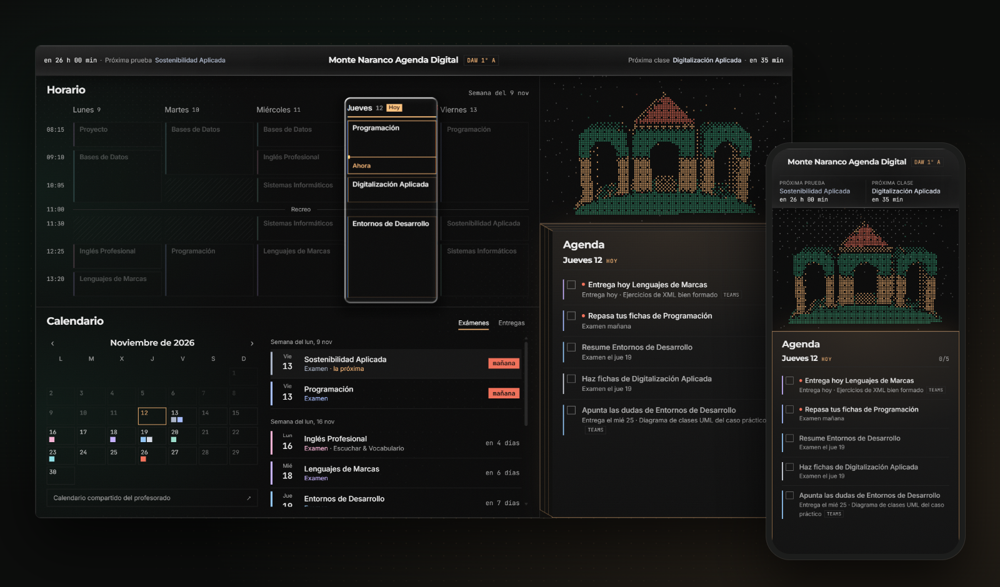
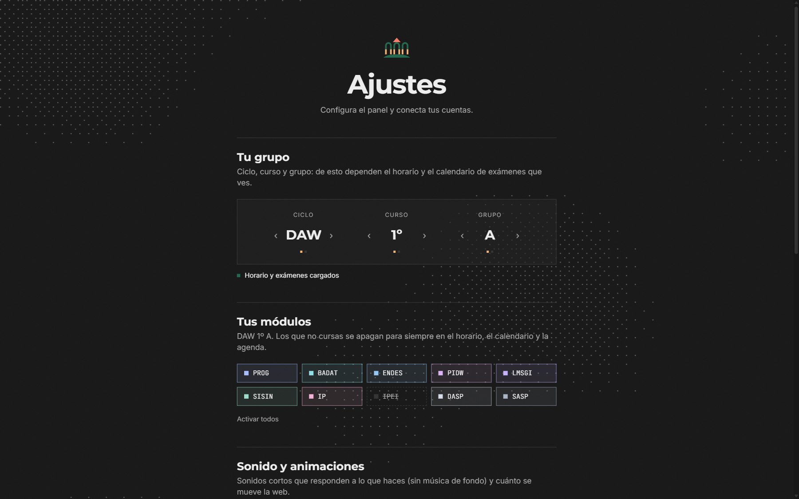
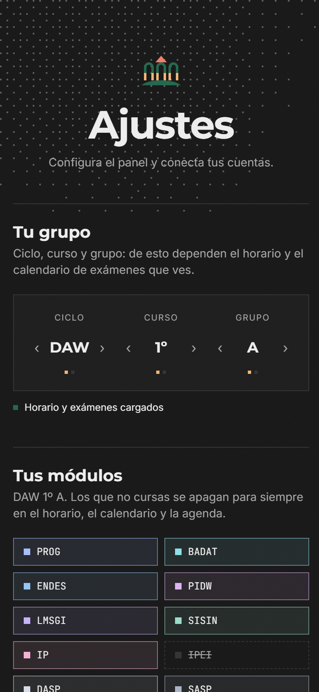
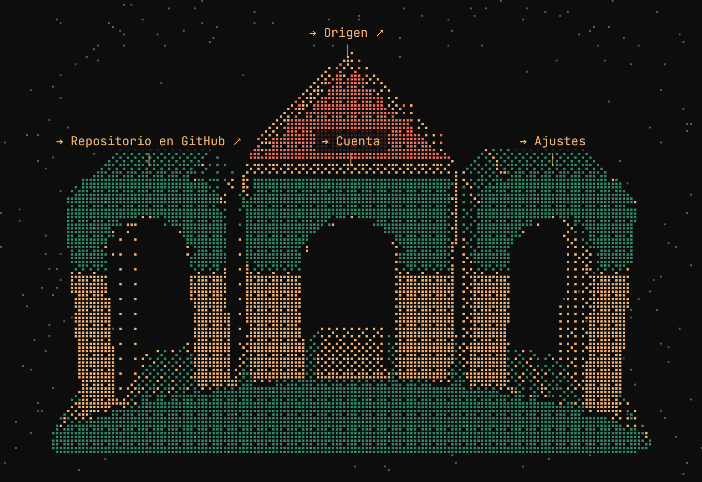
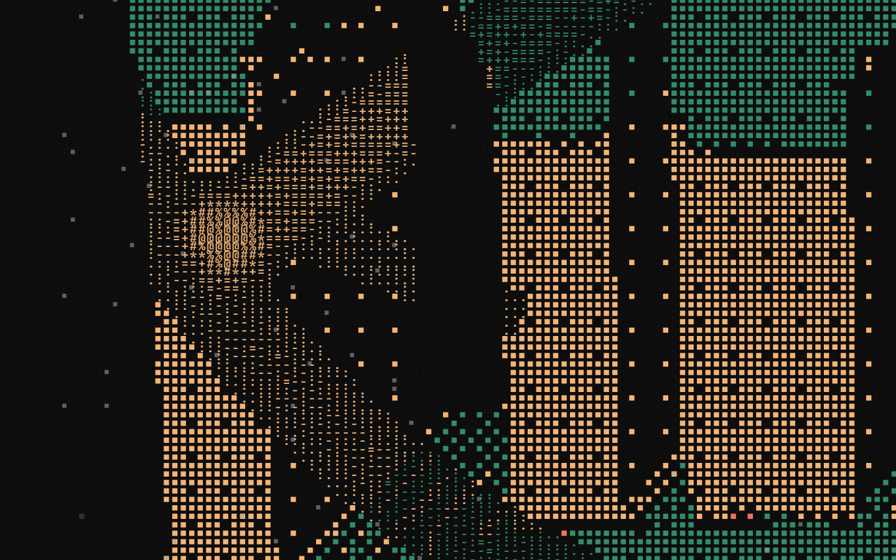
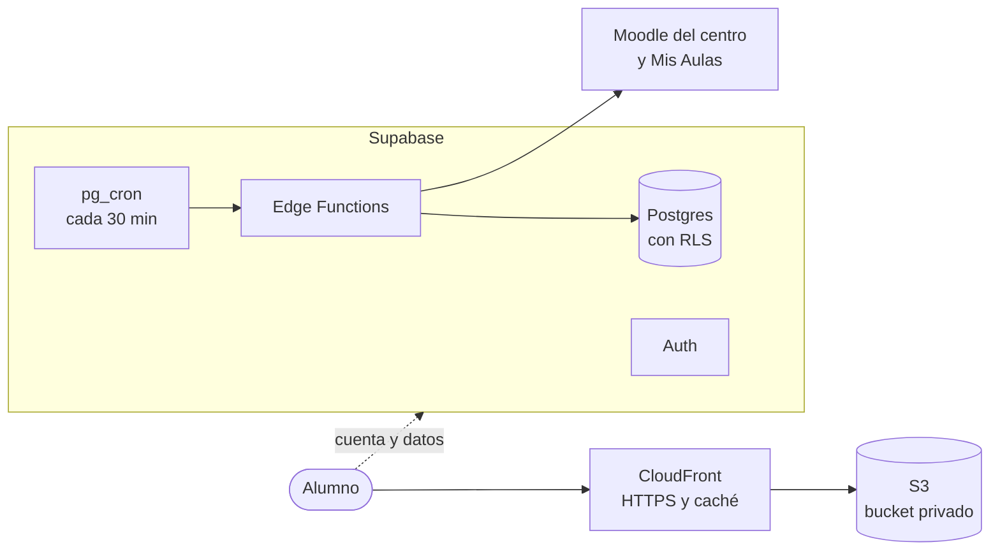
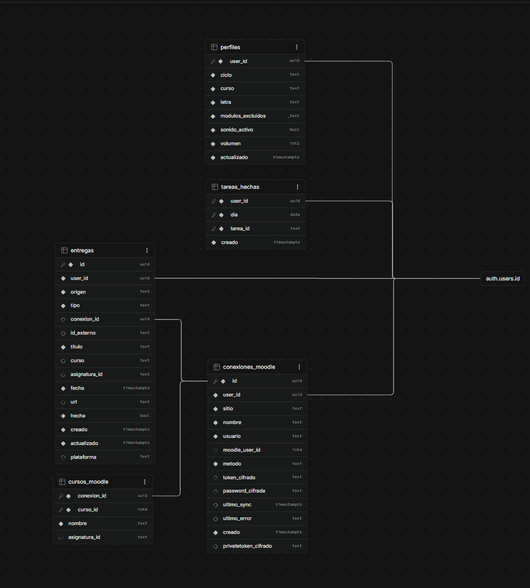

# Monte Naranco Agenda Digital

**Todas las tareas de un alumno de FP en un mismo sitio:** horario, exámenes, entregas de las plataformas del instituto y un plan para cada día.

> Proyecto personal de aprendizaje de un alumno de DAW. No es una herramienta oficial del IES Monte Naranco.

## De un vistazo

| | |
|---|---|
| **Qué es** | Una web que junta todo lo que un alumno tiene que hacer y le propone por dónde empezar cada día. |
| **Mi punto de partida** | Java en el backend y HTML básico. Es mi primer proyecto con React, TypeScript, animaciones y un backend como servicio. |
| **Tiempo** | 7 días de trabajo, entre el 28 de octubre y el 8 de noviembre de 2026. |
| **Tamaño** | ~8.700 líneas de TypeScript · 28 componentes · 5 tablas · 5 funciones en el servidor. |
| **Stack** | React 19 · TypeScript · Tailwind CSS 4 · Motion · GSAP · Supabase · AWS |
| **Estado** | Publicada y funcionando. Terminada, sin mantenimiento ([por qué](#por-qué-no-continúa)). |

## Pruébala

Entra en **[agenda.alvaro.cloud](https://agenda.alvaro.cloud)** → *Iniciar sesión* con la cuenta de prueba:

| Correo | Contraseña |
|---|---|
| `test@admin.is` | `admin123` |

Verás el panel con el horario y los exámenes de DAW 1º A. Puedes mover la lupa por la semana, centrarte en una asignatura, marcar tareas como hechas y cambiar los ajustes.

**Es una cuenta compartida con la contraseña pública, así que el servidor la protege:**

| Protección | Por qué | Cómo |
|---|---|---|
| No se puede borrar | Si no, el primero que entrara la dejaría inservible para todos. | La función `borrar-cuenta` la rechaza. |
| No puede conectar Moodle ni Mis Aulas | Nadie debe dejar ahí sus credenciales para el siguiente visitante. | La función `conectar-moodle` la rechaza. |
| No puede añadir tareas | Nadie puede dejar textos o enlaces a quien entre después. | Una política **RLS** de la base de datos impide insertarlas. |

La web lo explica en cada sitio ("No disponible en la cuenta de prueba"), pero la protección real está en el servidor. Lo comprobé intentando cada operación desde fuera de la web, con la clave pública: las tres se rechazan.

---

## El problema

Para saber qué tenía que hacer cada día, un alumno de mi ciclo consultaba **cinco sitios**: Teams, el Moodle del instituto, un segundo Moodle ("Mis Aulas"), el horario en PDF y los avisos de exámenes. Ninguno sabía nada de los demás.

Esta web los junta en una pantalla y responde a una pregunta: **¿qué hago hoy?**

## Qué hace

- **Agenda del día:** exámenes y entregas ordenados por prioridad ("Atrasada…", "Termina…", "Repasa…"), solo de las asignaturas que tienes ese día. Cada tarea se marca como hecha y, si viene del aula virtual, se abre con un clic.
- **Horario con lupa de cristal (WebGL):** la lupa marca el día elegido. Al pulsar una asignatura, toda la web se centra en ella.
- **Calendario** de exámenes y de entregas, con las atrasadas arriba, y **cuentas atrás** hasta la próxima prueba y la próxima clase.
- **Entregas automáticas:** el Moodle del centro se sincroniza solo cada 30 minutos; Mis Aulas, cuando el alumno lo pide ([por qué](#4-las-plataformas-del-instituto-no-están-pensadas-para-esto)). Las de Teams se apuntan a mano.
- **Cuentas:** registro, inicio de sesión y borrado de la cuenta con contraseña. Todo se sincroniza entre el móvil y el ordenador.
- **Configuración:** grupo, asignaturas convalidadas, sonido y animaciones simplificadas.
- **Primera visita:** configuración guiada paso a paso y un tutorial de 15 segundos.
- **Logo 3D como menú:** el logo del instituto, hecho de puntos, gira con el ratón (en el móvil, con el giroscopio) y sus puertas son botones.

## Escritorio y móvil

En escritorio, el panel cabe exacto en la pantalla, sin scroll. En el móvil, las celdas se apilan y el horario tiene su propia vista.

| | Escritorio | Móvil |
|---|---|---|
| **Panel** |  |  |
| **Landing** |  |  |
| **Ajustes** |  |  |

### El logo 3D

| El logo es el menú | El logo en ASCII |
|---|---|
|  |  |
| Cada parte del edificio es un botón. **Tejado:** la web madre ([alvaro.cloud](https://alvaro.cloud)). **Puerta central:** la cuenta. **Derecha:** Ajustes. **Izquierda:** este repositorio. | Al pasar el ratón, los puntos se convierten en caracteres (`. : - = + * # % @`) según el "calor" que deja el cursor, y al pulsar sale una onda. Hecho a mano en Canvas a partir de una [referencia artística](#inspiración-artística). |

En la web aparece solo el nombre de la puerta que señalas; aquí se ven los cuatro a la vez. La captura del ASCII está ampliada y con el efecto intensificado para que se aprecie en una imagen fija.

| Tutorial de la primera visita | Horario en el móvil |
|---|---|
|  |  |

---

## Cómo está construido

| | Qué uso | Por qué |
|---|---|---|
| **Frontend** | React 19, TypeScript, Tailwind CSS 4, Motion y GSAP | Tipos como en Java, estilos con tokens de diseño y la mejor herramienta para cada tipo de animación. |
| **Gráficos y sonido** | Canvas 2D, WebGL y Web Audio, **sin librerías** | El logo 3D, la lupa y el sonido están hechos a mano: quería entender cómo funcionan por dentro. |
| **Backend** | Supabase: Auth, Postgres, Edge Functions y `pg_cron` | Cuentas, base de datos y código en el servidor **sin mantener un servidor propio**. Descarté Spring Boot por eso. |
| **Alojamiento** | AWS: bucket S3 privado servido por CloudFront | Web estática con HTTPS en mi dominio, pagando solo por uso. Se publica con `npm run deploy`. |

### El código, por capas

Lo organicé como lo haría en Java: la lógica no depende de la interfaz.

| Capa | Carpeta | Qué contiene | En Java sería… |
|---|---|---|---|
| Dominio | `src/lib/` | Funciones puras: fechas, horario, prioridades de la agenda | Servicios |
| Estado | `src/hooks/` | Estado reutilizable y sincronizado con la cuenta | Beans con estado |
| Interfaz | `src/components/` | Lo que se pinta y responde a eventos | Vistas y controladores |
| Servidor | `supabase/functions/` | Moodle, cifrado y borrado de cuentas | Endpoints REST |
| Base de datos | `supabase/migrations/` | Tablas, permisos y RLS en SQL versionado | Flyway |

### La base de datos

Cinco tablas en Postgres, todas unidas a las cuentas (`auth.users`) con borrado en cascada: al eliminar una cuenta, desaparece todo lo suyo.

- **`perfiles`:** grupo, asignaturas convalidadas y sonido. Es lo que se sincroniza entre dispositivos.
- **`entregas`:** las entregas y los exámenes, vengan de Moodle o apuntados a mano.
- **`tareas_hechas`:** lo marcado como hecho en la agenda.
- **`conexiones_moodle` y `cursos_moodle`:** cada Moodle conectado, con sus credenciales **cifradas** (AES-256-GCM), y a qué asignatura corresponde cada curso.

Cada tabla tiene **RLS**: cada usuario solo puede leer y escribir sus propias filas. El esquema solo cambia con migraciones SQL versionadas, nunca a mano. Y no se guardan notas, mensajes ni archivos ([política de privacidad](docs/PRIVACIDAD.md)).

### Las plataformas del instituto

Antes de programar ninguna integración, investigué qué se podía leer y qué estaba permitido:

| Plataforma | ¿Se puede leer? | Cómo |
|---|---|---|
| Moodle del centro | ✅ Sí | API oficial de Moodle, con un token |
| Mis Aulas | ⚠️ Sí, pero frágil | Su API está apagada: hay que usar la misma vía interna que usa su web, con la contraseña cifrada |
| Teams (Educastur) | ❌ No | Educastur bloquea las apps externas. Las tareas se apuntan a mano |

---

## Diseño con intención

Cada decisión visual tiene un motivo:

- **Un color, un significado.** Arena es "ahora" (la clase en curso, el día de hoy), coral es urgente (hoy o mañana) y verde es la identidad del logo. Las asignaturas usan pasteles fríos que nunca se confunden con esos tres.
- **Tipografía con función.** Montserrat en los títulos (la de la web del instituto), Inter para leer y JetBrains Mono para horas y cifras: al ser monoespaciada, los números no "bailan" al cambiar.
- **El movimiento comunica.** La agenda se desliza hacia el lado al que cambias de día, la transición nace del botón pulsado y el estado de "pensando" explica la espera en vez de esconderla.
- **Un tema por página:** claro en la landing, gris en Ajustes y oscuro en el panel.

### Inspiración artística

Antes de escribir código reuní referencias visuales. De cada una tomé **una sola idea** y la adapté a la identidad del instituto.

*Una de las referencias: un objeto 3D hecho solo de puntos junto a una interfaz que enseña que está "pensando". De ella salió el estado "pensando" de la agenda, y reforzó la idea de construir el logo 3D solo con puntos.*

| Referencia | La idea | En qué se convirtió |
|---|---|---|
| Peces dibujados con puntos | Formas hechas solo de puntos | El logo 3D y el fondo de puntos |
| Faro de caracteres | Tipografía de terminal para los datos | Horas y cuentas atrás en monoespaciada |
| Interfaz que "piensa" | Explicar la espera | El "pensando" y la escritura de la agenda |
| Landing con flores ASCII | Página clara, titular grande | La landing clara |
| Rastro del ratón en ASCII | Calor que convierte puntos en caracteres | La estela del ratón sobre el logo |

Todas las referencias, con sus imágenes, están en [docs/INSPIRACION.md](docs/INSPIRACION.md).

---

## Problemas que resolví

### 1. Las animaciones dependían del sistema operativo
- **Problema:** la web obedecía al ajuste de "reducir movimiento" del sistema (`prefers-reduced-motion`), y cada pieza lo leía por su cuenta: Motion, GSAP, Tailwind y los canvas. En un ordenador con los efectos de animación desactivados, la web perdía la landing animada, el logo y la escritura sin que el usuario supiera por qué. Y en un ordenador lento no había forma de quitarlas desde la web.
- **Solución:** una sola preferencia de la web, **"Animaciones simplificadas"**, en Ajustes. Es la única fuente de verdad (`lib/animaciones.ts`) y todos preguntan ahí: Motion a través de `MotionConfig`, GSAP rehaciendo la escena en cuanto cambia y Tailwind con dos variantes propias (`anima:` y `quieto:`). Se guarda por navegador y no por cuenta, porque depende del ordenador, no de la persona.
- **Aprendizaje:** una misma decisión repartida en cuatro sitios acaba fallando. Centralizarla, como un único bean de configuración en Spring, lo arregló todo de una vez.

### 2. La agenda daba tirones al cambiar de día
- **Problema:** medio segundo de retraso y saltos al mover la lupa por la semana.
- **Solución:** medí con el perfilador de Chrome en lugar de suponer, y aparecieron dos culpables. El fondo de puntos calculaba miles de senos por fotograma, y el efecto de escritura creaba un `` por letra, lo que forzaba ~82 ms de *layout*. Precalculé las ondas y reescribí la escritura moviendo un corte de texto, sin crear nodos.
- **Aprendizaje:** hay que medir antes de optimizar y comparar contra una línea base sin el efecto. La intuición apuntaba a React y el perfil, a otra cosa.

### 3. Un cristal WebGL encima de HTML
- **Problema:** un shader solo sabe leer imágenes, y el horario es HTML vivo, con colores que cambian al pasar el ratón.
- **Solución:** "fotografío" el horario en un canvas leyendo el DOM, lo subo a la GPU y lo deformo con una función de distancia (SDF). Un `MutationObserver` repinta la foto mientras dura cada transición CSS, y los clics atraviesan el cristal hasta el HTML de debajo.
- **Aprendizaje:** sincronizar dos mundos, el DOM y la GPU, exige saber exactamente cuándo cambia cada uno. Una foto con medio segundo de retraso se nota.

### 4. Las plataformas del instituto no están pensadas para esto
- **Problema:** dos de las tres plataformas no dejan leer las tareas desde fuera.
  - **Teams**, donde están 6 de mis asignaturas: Educastur tiene desactivado el consentimiento de usuario en Microsoft 365, así que ninguna app externa puede pedir permiso para leerlas.
  - **Mis Aulas** tiene su API apagada. La única vía es la misma que usa su web: iniciar sesión con el usuario y la contraseña del alumno. Así, cada sincronización automática es un inicio de sesión real: al alumno le llega un aviso de acceso nuevo cada vez, puede chocar con la sesión que tiene abierta y, repetido, parece actividad automatizada y pone su cuenta en riesgo de bloqueo.
- **Solución:** antes de programar, probé la vía oficial de cada plataforma.
  - **Teams:** evalué siete alternativas, descarté las que iban contra las normas y lo resolví con tareas apuntadas a mano.
  - **Mis Aulas:** la aislé como un método aparte, con la contraseña cifrada y la sesión cerrada al terminar. Primero espacié los inicios de sesión a uno cada 2 horas, sin reintentos si la contraseña falla (muchos intentos fallidos pueden bloquear la cuenta). No bastaba, así que la saqué de la sincronización automática: ahora solo se sincroniza cuando el alumno pulsa «Sincronizar ahora».
- **Aprendizaje:** que algo funcione no significa que sea sostenible. Investigar primero me ahorró construir lo imposible (Teams), y medir el riesgo de lo que sí funcionaba (Mis Aulas) es una de las razones por las que el proyecto no continúa.

### 5. Seguridad sin un servidor propio
- **Problema:** la web habla directamente con la base de datos, y la clave que lo permite es pública: está en el JavaScript.
- **Solución:** la seguridad vive en Postgres. Las tablas nacen cerradas y tienen dos cerrojos: permisos por rol y RLS (`auth.uid() = user_id`). Lo que necesita privilegios (hablar con Moodle, cifrar credenciales, borrar cuentas) va en Edge Functions. Para borrar la cuenta se pide la contraseña, y se comprueba en el servidor, no en la web.
- **Aprendizaje:** la prueba que importa es la del atacante. Pedí los datos sin sesión, con la clave pública, y la respuesta fue `permission denied`.

Los trece retos, con todo el detalle, están en [docs/PROCESO.md](docs/PROCESO.md#3-los-mayores-retos-técnicos).

---

## Cómo he trabajado

- **Investigar antes de programar.** Las pruebas con Moodle y Microsoft Graph decidieron la arquitectura antes de escribir una línea.
- **Medir antes de optimizar.** Perfiles de CPU y tiempos por fotograma, no intuiciones.
- **Comprobar en un navegador real.** Cada cambio lo verificaba con scripts de Puppeteer: capturas en varios tamaños de pantalla, errores de consola, rendimiento y comparación de píxeles.
- **Cambios pequeños,** con un plan antes del código.

**Con IA.** Lo desarrollé con [Claude Code](https://claude.com/claude-code), siguiendo unas reglas escritas en el propio repositorio ([CLAUDE.md](CLAUDE.md)): plan antes del código, cambios pequeños y cada técnica explicada por su nombre y con su equivalente en Java. La mayor parte la hice en modo *delegar*: la IA programaba y me explicaba los conceptos al terminar cada bloque, y yo decidía qué hacer, lo revisaba y lo comprobaba. Las correcciones que más mejoraron la web fueron mías, al usarla: "antes del cambio no pasaba", "esto sobrecarga demasiado". Las credenciales de AWS y Supabase nunca pasaron por la IA.

## Qué he aprendido

Lo que traía de Java me sirvió: separar capas, tipar y pensar en servicios. Lo nuevo fue todo lo demás:

- **React y el estado:** dónde debe vivir cada estado y cuándo algo *no* debe serlo. Lo que cambia 60 veces por segundo va directo al DOM o a un canvas.
- **El navegador por dentro:** qué provoca un *layout*, cómo se pinta un canvas, qué es un shader y por qué el audio no suena hasta el primer clic.
- **Rendimiento con datos:** perfilar, comparar contra una línea base y demostrar con hashes de píxeles que una optimización no cambia nada visible.
- **Backend sin servidor:** RLS, roles, claves públicas y secretas, Edge Functions y migraciones versionadas.
- **Infraestructura:** S3, CloudFront, certificados, DNS y cachés.
- **Diseño:** un color para cada significado, y que quitar también es diseñar.

---

## Por qué no continúa

La web funciona y es útil tal como está, pero el siguiente paso no depende de mí:

- **Teams** (6 de mis asignaturas) exige que Educastur apruebe la app, y las alternativas van contra sus condiciones de uso.
- **Mis Aulas** tiene su API apagada. Sincronizar obliga a iniciar sesión una y otra vez, lo que choca con la sesión del propio alumno y **pone en riesgo de bloqueo su cuenta**. Por eso ya solo se sincroniza a mano.
- **El horario y los exámenes** solo se podrían automatizar si el profesorado los publicara en una herramienta común. Hoy viven en PDF y avisos sueltos. Por eso solo hay datos de DAW 1º A.

Para retomarlo haría falta que Educastur aprobara la app, que Mis Aulas activara su API y que el profesorado publicara un calendario común. Todo lo investigado está en [docs/INTEGRACIONES.md](docs/INTEGRACIONES.md).

## Posibles mejoras futuras

Si el proyecto se retomara, estas serían las dos siguientes piezas:

- **Un calendario común para todas las clases.** Hoy el horario y los exámenes salen de archivos del proyecto, y solo hay datos de DAW 1º A. La idea es que el profesorado publique horarios y exámenes en un único calendario centralizado, con una tabla en Supabase y permisos por rol (el profesor escribe, el alumno solo lee). La web lo leería para cualquier grupo, de DAW o DAM y de 1º o 2º, y cada clase tendría su agenda sin tocar el código.
- **Una agenda que genere las tareas con IA.** Hoy la agenda propone tareas con reglas fijas según las fechas ("Repasa…", "Termina…"). Con un modelo de inteligencia artificial, llamado desde una Edge Function para que su clave nunca llegue al navegador, cada examen y cada entrega se convertiría en un plan a medida: repartir el repaso en sesiones según las horas libres del horario, estimar cuánto cuesta cada tarea y adaptarse a lo que el alumno ya ha marcado como hecho. Solo se le enviarían títulos y fechas, nunca datos personales.

---

## Documentación

| | |
|---|---|
| [PROCESO.md](docs/PROCESO.md) | Cómo se hizo, día a día: decisiones, los trece retos, ideas descartadas y lo aprendido. |
| [ARQUITECTURA.md](docs/ARQUITECTURA.md) | El frontend por dentro: flujo de datos, rutas y cada técnica. |
| [BACKEND.md](docs/BACKEND.md) | Supabase: tablas, seguridad, autenticación y pruebas. |
| [INTEGRACIONES.md](docs/INTEGRACIONES.md) | La investigación de Moodle y Teams, prueba a prueba. |
| [INSPIRACION.md](docs/INSPIRACION.md) | Las referencias artísticas y en qué se convirtió cada una. |
| [PRIVACIDAD.md](docs/PRIVACIDAD.md) | La política de privacidad. |

**Arrancarlo en local:** `npm install` y después `npm run dev` (Node.js 20.19 o superior).

**Créditos:** logo del IES Monte Naranco · sonidos de [SND](https://snd.dev) (Dentsu Lab Tokyo) · tipografías Montserrat, Inter y JetBrains Mono.
