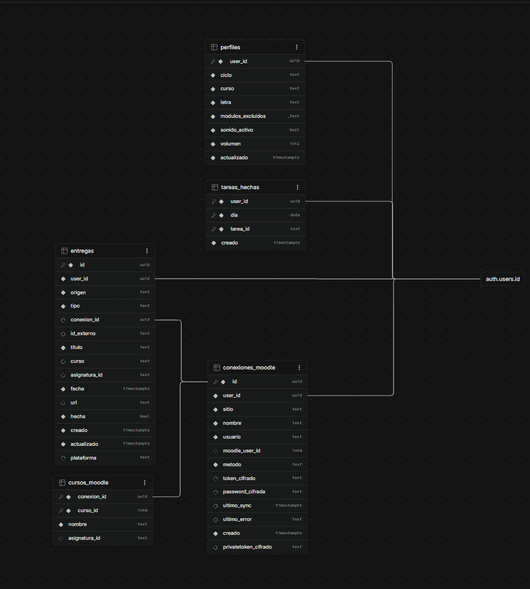

# Backend: Supabase

Cómo y por qué la agenda pasó de ser una web solo de frontend a tener **cuentas de usuario reales y una base de datos**. Este documento explica la elección de Supabase, cómo se ha montado paso a paso, la seguridad de los datos y lo que queda por hacer.

> Para el *porqué* del backend (leer las entregas de Moodle y Teams) ver [INTEGRACIONES.md](INTEGRACIONES.md). Para el resto de la web, [ARQUITECTURA.md](ARQUITECTURA.md).

---

## Índice

1. [Por qué hacía falta un backend](#1-por-qué-hacía-falta-un-backend)
2. [Qué es Supabase](#2-qué-es-supabase)
3. [Por qué Supabase y no otra cosa](#3-por-qué-supabase-y-no-otra-cosa)
4. [Cómo se ha montado, paso a paso](#4-cómo-se-ha-montado-paso-a-paso)
5. [La base de datos: tabla `entregas`](#5-la-base-de-datos-tabla-entregas)
6. [Seguridad: claves, permisos y RLS](#6-seguridad-claves-permisos-y-rls)
7. [Autenticación: registro e inicio de sesión](#7-autenticación-registro-e-inicio-de-sesión)
8. [Cómo lo usa el frontend](#8-cómo-lo-usa-el-frontend)
9. [Pruebas realizadas](#9-pruebas-realizadas)
10. [Cómo trabajar con la base de datos](#10-cómo-trabajar-con-la-base-de-datos)
11. [Lo añadido después](#11-lo-añadido-después-2-nov-2026)
12. [Sincronización automática, cursos y tareas a mano](#12-sincronización-automática-cursos-y-tareas-a-mano-3-nov-2026)
13. [Próximos pasos](#13-próximos-pasos)

---

## 1. Por qué hacía falta un backend

Hasta ahora la web era **estática**: archivos en S3 servidos por CloudFront, con los datos en archivos JSON dentro del proyecto y las preferencias en `localStorage`. Eso basta para enseñar un horario, pero no para lo siguiente que pide el proyecto:

- **Cuentas de verdad:** que cada alumno tenga lo suyo y lo vea en cualquier dispositivo.
- **Guardar datos propios:** las tareas que el alumno añade a mano, por ejemplo las de Teams, que no se pueden leer automáticamente.
- **Hablar con otras webs:** leer las entregas de los Moodle del instituto exige guardar credenciales, ejecutar código en un servidor (desde el navegador no se puede, por CORS y por seguridad) y hacerlo de forma periódica.

Nada de eso cabe en una web estática: hace falta un **backend**.

## 2. Qué es Supabase

Supabase es un **backend ya montado**. En vez de programar y mantener un servidor, ofrece hechas las piezas que casi todas las aplicaciones necesitan. Todo gira alrededor de **PostgreSQL**, una base de datos relacional normal, la misma que se usaría con Spring Boot.

| Pieza | Qué hace | En Java sería… |
|---|---|---|
| **PostgreSQL** | La base de datos, con SQL de verdad: tablas, claves foráneas, índices, triggers | Postgres o MySQL de siempre |
| **Data API** | Genera sola una **API REST** para cada tabla, sin escribir controladores | Un `@RestController` + `JpaRepository` que no hay que programar |
| **RLS** (Row Level Security) | La base de datos filtra **por fila** quién ve qué | Un `WHERE user_id = ?` que pone la base de datos y nadie se puede saltar |
| **Auth** | Registro, login, sesiones con JWT, recuperación de contraseña | Spring Security + la tabla de usuarios |
| **Edge Functions** | Funciones en TypeScript que se ejecutan en sus servidores | Un endpoint suelto, sin servidor que mantener |
| **pg_cron** | Tareas programadas dentro de la base de datos | `@Scheduled` |
| **Vault** | Secretos cifrados dentro de la base de datos | Un almacén de claves |
| **`supabase-js`** | La librería del frontend que habla con todo lo anterior | Un cliente HTTP ya configurado |

## 3. Por qué Supabase y no otra cosa

| Opción | Ventajas | Por qué no |
|---|---|---|
| **Spring Boot** (Java) | Lenguaje conocido por el autor | Un servidor encendido 24 horas: pagarlo, actualizarlo, vigilarlo. Y aun así faltarían el login y la base de datos |
| **Express (Node)** | Mismo lenguaje que el frontend | El mismo problema del servidor que mantener |
| **AWS Lambda + DynamoDB + Cognito** | Mismo proveedor que la web | Tres servicios que configurar y conectar, y una base de datos no relacional: demasiado para un primer backend |
| **Supabase** ✅ | Auth, base de datos, funciones y tareas programadas **sin servidor**; gratis a este tamaño; **SQL estándar** | Dependes de un proveedor (mitigado: es Postgres y se puede exportar) |

Encaja punto por punto con el plan de [INTEGRACIONES.md](INTEGRACIONES.md#5-plan-de-arquitectura):
- **Auth** sustituye el login de mentira de la landing.
- **Postgres + RLS** guarda las entregas de cada alumno por separado.
- **Edge Functions** conectan con Moodle.
- **pg_cron** sincroniza cada 30 minutos (ver §12).
- **Vault** guarda el secreto con el que pg_cron llama a la sincronización.

**Plan gratuito:** 500 MB de base de datos, 50.000 usuarios activos al mes y Edge Functions de sobra para un grupo de clase. Tiene una pega: **pausa el proyecto tras una semana sin actividad**, y queda comprobar si `pg_cron` cuenta como actividad.

## 4. Cómo se ha montado, paso a paso

### 4.1 El proyecto
Se creó en supabase.com como **`agenda-monte-naranco`**, plan Free y región europea. Al crearlo, Supabase pregunta cuatro cosas de seguridad que **no se pueden cambiar después**:

| Opción | Elegido | Por qué |
|---|---|---|
| Enable Data API | ✅ Sí | Es la API que usa `supabase-js` |
| Automatically expose new tables | ❌ No | Ninguna tabla nueva queda accesible "por defecto": cada migración da sus permisos a mano |
| Enable automatic RLS | ✅ Sí | Red de seguridad: si se olvida activar RLS en una tabla, se activa solo |
| Postgres type | Postgres (estándar) | OrioleDB está en beta |

Con esta combinación, **una tabla nueva nace cerrada por partida doble** (sin permisos y con RLS) hasta que una migración la abre explícitamente. Es el principio de **denegar por defecto**.

En **Authentication → URL Configuration**:
- **Site URL:** `https://agenda.alvaro.cloud`
- **Redirect URL extra:** `http://localhost:5173`

En **Authentication → Email** se **desactivó "Confirm email"**: quien se registra entra directamente, sin abrir un enlace en su correo.

### 4.2 La CLI y las migraciones
- **La CLI es dependencia de desarrollo** del proyecto (`npm i -D supabase`), así que la versión queda fijada en `package.json`, como un plugin en el `pom.xml`.
- **`npx supabase init`** creó `supabase/config.toml`, la configuración del entorno local, con las mismas URLs que el panel.
- **Migraciones:** los cambios de la base de datos son **archivos SQL versionados** en `supabase/migrations/`. Así el repositorio describe la base de datos real y cualquiera puede recrearla desde cero. Es lo que haría Flyway o Liquibase en un proyecto Java.

Para aplicarlas, desde la terminal del autor (las credenciales nunca pasan por el repositorio ni por la IA):

```bash
npx supabase login                                   # autoriza la CLI en el navegador
npx supabase link --project-ref zmjhnkqsulyyalvxoubn # vincula la carpeta con el proyecto (pide la contraseña de la BD)
npx supabase db push --remote --dry-run              # ENSAYO: qué migraciones aplicaría
npx supabase db push --remote                        # aplicarlas de verdad
```

**Un tropiezo:** en la versión 3 de la CLI, `db push` apunta por defecto a una base de datos **local** (Docker), y sin Docker falla con `ECONNREFUSED 127.0.0.1:54322`. Para ir al proyecto en la nube hay que pedirlo explícitamente con `--remote`, una buena protección contra tocar producción sin querer.

**Para comprobar** que local y remoto coinciden:
```bash
npx supabase migration list --remote
```

### 4.3 El servidor MCP (opcional)
Supabase ofrece un servidor MCP para que un asistente de IA consulte el proyecto. La recomendación fue configurarlo **en solo lectura** (`read_only=true`), sin las funciones de cuenta, y con `--scope local` para que su configuración no acabe en el repositorio público. Los cambios en la base de datos van siempre por migraciones, nunca con SQL suelto.

## 5. La base de datos: tabla `entregas`

### Esquema completo (versión final)

Cinco tablas en el esquema `public`. Todas cuelgan de `auth.users` (la tabla de cuentas de Supabase) con `on delete cascade`: al borrar una cuenta, desaparece todo lo suyo. Todas tienen **RLS** activado.



| Tabla | Qué guarda |
|---|---|
| `perfiles` | Grupo, módulos convalidados y sonido: lo que se sincroniza entre dispositivos. |
| `entregas` | Las entregas y exámenes de cada alumno, de Moodle (sincronizadas) o apuntadas a mano (Teams). |
| `tareas_hechas` | Las tareas de la Agenda marcadas como hechas, por día. |
| `conexiones_moodle` | Cada Moodle conectado, con sus credenciales **cifradas** (el navegador no puede ni pedir esas columnas). |
| `cursos_moodle` | Los cursos de cada Moodle y a qué asignatura del horario corresponden. |

La sincronización la lanza `pg_cron` cada 30 minutos, que llama a la Edge Function `sincronizar-todo`.

### La tabla `entregas`, columna a columna

Archivo: [supabase/migrations/20261102000000_entregas.sql](../supabase/migrations/20261102000000_entregas.sql).

Guarda las entregas y exámenes de cada alumno, **vengan de donde vengan**:

| Columna | Tipo | Para qué |
|---|---|---|
| `id` | `uuid`, PK | Identificador (`gen_random_uuid()`) |
| `user_id` | `uuid` → `auth.users` | Dueño. **Por defecto `auth.uid()`**: el frontend no lo envía, lo pone la base de datos |
| `origen` | `'manual' \| 'moodle'` | De dónde viene: a mano o de la sincronización |
| `plataforma` | `text`, 1-40 caracteres | Solo en las manuales: de qué plataforma son (`'Teams'`), para su etiqueta en la Agenda. Añadida el 3 nov (§12) |
| `tipo` | `'entrega' \| 'examen'` | Igual que los eventos del JSON actual |
| `conexion_id`, `id_externo` | | Solo para lo que venga de Moodle: de qué conexión y con qué id |
| `titulo` | `text`, 1-200 caracteres | Qué hay que entregar |
| `curso`, `asignatura_id` | | El curso en la plataforma y su asignatura en la web (color y nombre) |
| `fecha` | `timestamptz` | Fecha y hora límite |
| `url` | `text`, debe empezar por `http(s)://` | Enlace a la tarea |
| `hecha` | `boolean` | Marcada como hecha (sincronizada entre dispositivos) |
| `creado`, `actualizado` | `timestamptz` | `actualizado` lo pone un **trigger** en cada `UPDATE` (como `@PreUpdate` de JPA) |

- **`unique (user_id, origen, id_externo)`:** al sincronizar, una tarea de Moodle no se duplica. En las manuales `id_externo` es `null`, y en Postgres dos `null` no chocan, así que se pueden añadir todas las que se quiera.
- **Índice `(user_id, fecha)`:** para la consulta típica, "mis entregas por fecha".

**Cambios respecto al borrador** de [INTEGRACIONES.md §5.1](INTEGRACIONES.md#51-borrador-del-modelo-de-datos):
- `origen` es `'manual'` y no `'teams-manual'`: el formulario a mano sirve para Teams y para cualquier otra plataforma sin integración.
- Se añadió `tipo`, para poder apuntar también exámenes.
- La clave foránea a `conexiones_moodle` se añadirá cuando exista esa tabla, en su propia migración.

## 6. Seguridad: claves, permisos y RLS

### Claves
| Clave | ¿Pública? | Dónde está |
|---|---|---|
| **Project URL** y **Publishable key** (`sb_publishable_…`) | **Sí**, por diseño | En [src/lib/config.ts](../src/lib/config.ts): van en el JavaScript de la web |
| **Secret key** / `service_role` | **No**, nunca | Solo en el panel de Supabase y, en el futuro, en los secretos de las Edge Functions |
| **Contraseña de la base de datos** | **No** | En el gestor de contraseñas del autor. Solo la pide `supabase link` |
| **Token de la CLI** | **No** | En el perfil del usuario del equipo (lo crea `supabase login`) |

En una SPA, todo lo que está en el JavaScript lo puede leer cualquiera, y el repositorio además es público. Por eso **la protección no puede ser esconder la clave pública, sino que la base de datos decida quién puede hacer qué**.

### Dos cerrojos
1. **Permisos (`grant` / `revoke`):** deciden si un **rol** puede tocar la tabla.
   - `authenticated` (con sesión iniciada): `select`, `insert`, `update` y `delete`.
   - `anon` (sin sesión): **nada** (`revoke all`).
2. **RLS:** decide **qué filas**. Hay cuatro políticas, una por operación, todas con la misma condición:
   ```sql
   (select auth.uid()) = user_id
   ```
   La base de datos añade esa condición a **cada consulta**. Un usuario no puede leer, cambiar ni borrar filas ajenas, ni insertar filas a nombre de otro (`with check`).

El `auth.uid()` va dentro de un `select` entre paréntesis por recomendación oficial de Supabase: así Postgres lo calcula **una vez por consulta** y no una vez por fila.

## 7. Autenticación: registro e inicio de sesión

- **Registro** (`supabase.auth.signUp`): correo, contraseña de al menos 6 caracteres y nombre. El nombre se guarda en los **metadatos del usuario** (`user_metadata.nombre`), sin tabla aparte. Como la confirmación de correo está desactivada, devuelve la sesión al momento.
- **Login** (`supabase.auth.signInWithPassword`).
- **Repetir la bienvenida:** desde Ajustes se puede marcar la cuenta (`user_metadata.repetir_bienvenida`, con `supabase.auth.updateUser`) para que el próximo inicio de sesión, en cualquier dispositivo, lleve otra vez a la configuración guiada y al tutorial. El login borra la marca al usarla. No hace falta tabla ni migración, y los datos no se tocan: solo cambia cómo se enseñan.
- **Sesión:** `supabase-js` la guarda en `localStorage` y renueva el token solo. Al recargar, sigues dentro.
- **Errores en español,** traducidos por su **código** y no por el texto, que puede cambiar (en Java sería capturar la excepción por su tipo y no comparar `getMessage()`):

| Código | Mensaje |
|---|---|
| `invalid_credentials` | Correo o contraseña incorrectos |
| `user_already_exists` / `email_exists` | Ya existe una cuenta con ese correo |
| `weak_password` | La contraseña es demasiado débil |
| `over_request_rate_limit` | Demasiados intentos seguidos |
| (error de red) | No hay conexión |

## 8. Cómo lo usa el frontend

| Archivo | Qué hace |
|---|---|
| [src/lib/config.ts](../src/lib/config.ts) | La URL y la clave pública, junto al resto de la configuración |
| [src/lib/supabase.ts](../src/lib/supabase.ts) | El **único cliente** de Supabase (como un bean singleton) y `mensajeDeError()` |
| [src/hooks/useSesion.ts](../src/hooks/useSesion.ts) | Quién ha iniciado sesión (`usuario`, `nombre`, `cargando`). Se suscribe a `onAuthStateChange` (patrón Observer), así que se entera de entradas, salidas y renovaciones, también desde otra pestaña. Incluye `cerrarSesion()` |
| [src/components/landing/Acceso.tsx](../src/components/landing/Acceso.tsx) | El formulario: registro → Ajustes con la configuración guiada; login → panel. Lee los campos con `FormData` (formulario no controlado). Con sesión iniciada muestra quién eres, "Ir al panel" y "Cerrar sesión" |
| [src/components/sections/Ajustes.tsx](../src/components/sections/Ajustes.tsx) | La sección **"Tu cuenta"**: tu nombre y correo con "Cerrar sesión", o "Iniciar sesión" |

**Rendimiento:** `supabase-js` pesa unos 56 kB comprimidos. Solo se importa desde la landing y Ajustes, que ya se cargaban aparte (*code splitting*), así que **el JavaScript inicial del panel no ha crecido**.

**El panel todavía no depende de la cuenta:** sigue mostrando los datos del JSON. Las entregas de la tabla se mezclarán con ellos en el siguiente paso.

## 9. Pruebas realizadas

Contra el proyecto real, sin crear datos de prueba:

| Prueba | Resultado |
|---|---|
| Leer `entregas` **sin sesión**, solo con la clave pública (lo que podría hacer cualquiera con el código del repo) | ❌ `permission denied for table entregas` (HTTP 401) ✅ |
| Insertar en `entregas` sin sesión | ❌ `permission denied` (HTTP 401) ✅ |
| Login con datos falsos en la web | El botón pasa a "Entrando…" y aparece "Correo o contraseña incorrectos" ✅ |
| Ajustes de Auth (`/auth/v1/settings`) | `mailer_autoconfirm: true` (sin confirmar correo) ✅ |
| Registro real (lo hizo el autor) | Cuenta creada, redirección a Ajustes y usuario visible en *Authentication → Users* ✅ |
| `migration list --remote` | Local y remoto en `20261102000000` ✅ |

El 401 sin sesión **no lo produce el RLS, sino el `revoke` de antes**: el rol `anon` ni siquiera tiene permiso sobre la tabla. Son dos cerrojos independientes.

## 10. Cómo trabajar con la base de datos

**Un cambio nuevo** (por ejemplo, la tabla `conexiones_moodle`):
1. Crear `supabase/migrations/<AAAAMMDDhhmmss>_<nombre>.sql`. Toda tabla nueva lleva su `enable row level security`, sus políticas y sus `grant` / `revoke` explícitos.
2. `npx supabase db push --remote --dry-run`: comprobar que solo aparece la nueva.
3. `npx supabase db push --remote`.
4. Probar con la clave pública que, **sin sesión, no se puede leer ni escribir**.

**Nunca:**
- cambiar tablas a mano en el panel sin migración, porque el repositorio dejaría de describir la base de datos real;
- poner la `service_role` en el frontend;
- escribir contraseñas, tokens o cookies en logs.

## 11. Lo añadido después (2 nov 2026)

| Migración / función | Qué hace |
|---|---|
| `20261102180000_perfiles.sql` | Ajustes en la cuenta (grupo, módulos, sonido). Sincronizados por `useAjustesEnLaNube`: al iniciar sesión manda la nube |
| `20261102200000_tareas_hechas.sql` | Tareas de la Agenda marcadas como hechas, por día (`useHechas` + `lib/hechas.ts`) |
| `20261102210000_conexiones_moodle.sql` | Conexiones de Moodle (token cifrado; el navegador **no puede pedir esa columna**: permisos por columna), cursos con su asignatura y la clave foránea de `entregas` |
| `functions/conectar-moodle` | Usuario y contraseña → token de Moodle → se guarda **cifrado** (AES-256-GCM, llave en el secreto `CLAVE_CIFRADO`) → primera sincronización. La contraseña no se guarda |
| `functions/sincronizar` | Lee la Línea de tiempo y deja `entregas` igual que Moodle (upsert de lo pendiente, borra lo entregado) |
| `functions/borrar-cuenta` | Borra el usuario; todo lo suyo se va en cascada (derecho de supresión del RGPD) |

**Seguridad de las funciones:**
- Comprueban ellas mismas quién llama (`verify_jwt = false` en `config.toml` y 401 sin sesión válida).
- CORS solo para `agenda.alvaro.cloud` y `localhost`.
- El navegador manda `sitio: 'centro'` y no una URL (sin SSRF).
- Usan `service_role`, que nunca sale del servidor.

**Publicarlas:**
```bash
npx supabase functions deploy --use-api
npx supabase secrets set CLAVE_CIFRADO=…   # 32 bytes en base64; si se pierde, hay que reconectar Moodle
```

## 12. Sincronización automática, cursos y tareas a mano (3 nov 2026)

| Migración / función | Qué hace |
|---|---|
| `20261103120000_privatetoken.sql` | Guarda también el `privatetoken` de Moodle (cifrado), necesario para pedir la clave de **autologin** |
| `functions/abrir-tarea` | Devuelve a su dueño, y solo a él, lo necesario para que **el navegador** pida a Moodle el enlace con sesión iniciada (la clave de Moodle va ligada a la IP de quien la pide) |
| `20261103180000_sincronizacion_automatica.sql` | Activa `pg_cron` y `pg_net`, crea el secreto en Vault y programa la sincronización cada 30 minutos |
| `functions/sincronizar-todo` | Sincroniza las conexiones de **todos** los alumnos. Solo la puede disparar pg_cron |
| `20261103180100_plataforma_tareas_manuales.sql` | Columna `plataforma` en `entregas` |

### 12.1 Cada 30 minutos, sin pulsar nada

```
pg_cron ('*/30 * * * *')                       ≈ @Scheduled(cron = "0 */30 * * * *")
  └─ pg_net: POST /functions/v1/sincronizar-todo
       cabecera x-cron-secreto ← Vault
         └─ sincronizar-todo
              ├─ comprueba el secreto (comparación en tiempo constante)
              └─ de 3 en 3: sincronizarConexion()  (el mismo código que el botón "Sincronizar ahora")
```

**El secreto no está en el repositorio.** Lo genera la propia migración dentro de Postgres (`gen_random_bytes(32)`) y lo guarda cifrado en **Vault**. La función lo compara con el que le devuelve `secreto_cron()`, una función `security definer` que solo puede ejecutar `service_role`. Así nadie de fuera puede disparar una sincronización masiva, aunque la función tenga `verify_jwt = false`.

**Cortesía con las webs del instituto:**
- Conexiones de 3 en 3, no todas a la vez.
- **Mis Aulas** (método B) inicia sesión en cada sincronización: como mucho **una vez cada 2 horas**, no cada 30 minutos.
- Si Moodle ya rechazó la contraseña o el token, **no se insiste**: muchos intentos fallidos podrían bloquear la cuenta del alumno. Se espera a que vuelva a conectar, lo que borra el error.

**Comprobar que funciona** (SQL Editor del panel):
```sql
select status, return_message, start_time from cron.job_run_details order by start_time desc limit 5;
select status_code, content from net._http_response order by created desc limit 5;
-- content: {"revisadas":…, "saltadas":…, "correctas":…, "fallos":…}
```

### 12.2 Corregir la asignatura de cada curso

La sincronización **adivina** la asignatura de cada curso por su nombre (`_shared/asignaturas.ts`). En **Ajustes → Sincronizar → Cursos y asignaturas** el alumno la corrige con un desplegable:
- El navegador actualiza `cursos_moodle.asignatura_id` (el único campo que `authenticated` puede cambiar: permiso por columna) y, al momento, el de sus entregas.
- La siguiente sincronización **respeta** lo guardado: solo adivina los cursos nuevos. "Sin asignatura" también se respeta.

### 12.3 Tareas de Teams a mano

Teams no se puede leer (ver [INTEGRACIONES.md §4](INTEGRACIONES.md#4-teams-qué-se-ha-probado-y-por-qué-no-se-puede-automatizar)), así que en **Ajustes → Sincronizar → Teams** hay un formulario: título, fecha (y hora opcional; sin hora, las 23:59), asignatura y enlace opcional.
- Se insertan **directamente desde el navegador** en `entregas` con `origen = 'manual'` y `plataforma = 'Teams'`: no hace falta Edge Function, porque el RLS ya garantiza que cada uno solo crea y borra las suyas.
- La sincronización **nunca las toca**: solo borra filas de su `conexion_id`, y las manuales lo tienen a `null`.
- Salen en la Agenda y el Calendario con la etiqueta **TEAMS**, como las de Moodle con la suya.

## 13. Próximos pasos

1. **Comprobar el autologin** al abrir una tarea (consola del navegador: línea `[Agenda]`).
2. Comprobar si las llamadas de `pg_cron` evitan la **pausa del plan gratuito** tras una semana sin visitas.
3. **Teams automático** con el calendario ICS o Power Automate (aparcado, [INTEGRACIONES.md §4](INTEGRACIONES.md#4-teams-qué-se-ha-probado-y-por-qué-no-se-puede-automatizar)).
